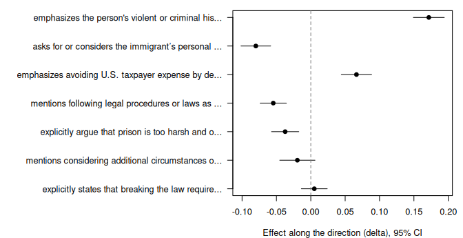

<!-- Rendered from vignettes/getting_started.Rmd for viewing on GitHub; do not edit by hand. -->

Getting started with saereg
================

Treatments and group differences often change texts in several ways at
once. SAE regression estimates such an effect on texts and decomposes it
into interpretable directions, in four steps.

1.  **Embed** each text, so that it becomes a vector that represents its
    meaning.
2.  **Learn directions** in that space with a sparse autoencoder (SAE),
    trained on one half of the texts. Each direction tends to capture
    one recurring concept, such as an argument.
3.  **Label** each direction with a large language model or a human
    reader, from the training texts that score highest on it.
4.  **Estimate and decompose** on the other half. Regress the embeddings
    on the treatment. The coefficient vector is the effect on the
    average text; projected onto each direction, it shows how far the
    texts move towards or away from the direction and what share of the
    effect the direction explains.

This vignette goes through the four steps with the data shipped in the
package.

## Requirements

Steps 1 to 3 run in Python, called from R. They need a Python
installation with `numpy`, `pandas`, `pyarrow`, `pyyaml`, `torch`,
`hypothesaes`, `tiktoken` and `openai`. `saereg` looks for one by itself
(`python3` and the usual Anaconda, Miniconda and Homebrew locations),
and `saereg_python()` shows which one it uses. To choose another, set it
once per session, for example:

``` r
options(saereg.python = "~/anaconda3/bin/python3")
```

Embedding and labeling call the OpenAI API, which needs a key in the
environment variable `OPENAI_KEY_SAE` and costs money. With
`dry_run = TRUE` the functions show what they would send without sending
it, which is what this vignette does; the package data hold what the
real calls returned. Step 4 needs only R.

## The data

`egami` holds the open-ended answers from Experiment 3 of Egami et
al. (2022). Respondents read about a 28-year-old man convicted of
entering the United States illegally. In the treatment condition
(`treat = 1`), he had previously served two prison sentences, one for a
violent crime, and had been deported. In the control condition, he had
never been imprisoned. Respondents then explained what the US government
should do and why. The answers were split at random into a training half
and a test half, as in Egami et al.

``` r
library(saereg)
d <- egami$data
table(train = d$train, treat = d$treat)
#>        treat
#> train     0   1
#>   FALSE 254 259
#>   TRUE  262 259
substr(d$text[1:3], 1, 80)
#> [1] "No victim, no crime. Just send him right back and move on."                      
#> [2] "just based on my gut feeling this is how i feel.  I feel he should not be sent t"
#> [3] "They should send him to prison to serve time for his crimes.  After that they ne"
```

## Step 1: embed the texts

`embed_texts()` sends the texts to an OpenAI embedding model (by default
`text-embedding-3-large`, 3,072 dimensions) and returns one row per
text.

``` r
embed_texts(d$text, dry_run = TRUE)
#> [dry run] would embed 1034 documents (42,638 tokens; 0 longer than 8191 tokens, sent as 0 chunks) with text-embedding-3-large in 1 requests
```

Without `dry_run`, `embed_texts(d$text)` returns the matrix. `egami$E`
is what it returned.

``` r
E <- egami$E
dim(E)
#> [1] 1034 3072
```

## Step 2: learn directions with a sparse autoencoder

`train_sae()` trains the SAE on the rows marked `train` and returns its
decoder directions `W` (one column per direction) and the activations of
all texts. `M` is the number of directions and `K` the number active per
text; the answers are short (32 words at the median), so `K = 2`.

``` r
sae <- train_sae(E, M = 7, K = 2, seed = 7, train = d$train)
dim(sae$W)
#> [1] 3072    7
max(abs(sae$W - egami$W))
#> [1] 0
```

With the same seed and hardware, training reproduces the SAE exactly, as
the last line shows on the machine that built the package data. On other
hardware the directions can differ slightly, so the rest of the vignette
uses the stored ones.

``` r
W <- egami$W
```

## Step 3: label the directions

For each direction, `label_features()` ranks the training texts by their
score on it and shows a language model random texts from the bottom 10%,
the middle and the top 10%. The model names what the top texts do that
the others do not. Here is the prompt for direction 2.

``` r
prompts <- label_features(d$text[d$train], E[d$train, ], W, dry_run = TRUE)
cat(prompts[3])
#> You are a machine learning researcher studying one direction in a text-embedding space. Every text has a score on this direction.
#> Below, texts are grouped by their score, from the lowest scores (Group 1) to the highest (Group 3). Each group shows randomly chosen texts from its range.
#> Your goal is to describe what the texts with the highest scores (Group 3) do that the other texts do not. Use the lower groups to tell which features of Group 3 are distinctive and which are common to all texts.
#> 
#> GROUP 1 (score percentiles 0-10; 7 of 53 texts shown):
#> - If anything, the person should be deported if they illegally entered the country. The government should work with the mother nation and repatriate the person as best possible. Prison time would not be appropriate for this situation.
#> - I think the man should just be sent back to the country of his citizenship, where he came from. I don't think that he should be placed in jail because he was just seeking a better life for himself
#> - People entering the country illegally should not be imprisoned, but they should be detained and then sent back to their country of origin. They should be coming here through legal channels. We cannot just accept everyone who illegally makes it across our border.
#> - The gentleman should not be sent to prison as this was essentially a victimless crime. Assuming he would be deported, which would be punishment enough.
#> - He shouldn't be sent to jail, but rather deported. We shouldn't have to pay to house him and feed him while serving time. He should immediately be deported and if he wants to come to our country he should fill out the proper paperwork and go through the proper channels.
#> - No he should not be put in jail. He should just be made to go home and showed how to come here properly next time and be grounded from coming back for like 90 days or something.
#> - I don't think it's fair to send the man to prison, he hasn't done enough to warrant that in my opinion. I think they should just send him back to his country.
#> 
#> GROUP 2 (score percentiles 45-55; 7 of 53 texts shown):
#> - This isn't that big of a deal. Just let it go.
#> - just based on my gut feeling this is how i feel. I feel he should not be sent to prison . Actions should be avoided for the time being.
#> - I don't think entering a country illegally should be seen as a serious crime. His past is a bit sketchy, but that isn't a good reason to send him to prison.
#> - He is not violent or a threat to society, but simply immigrated illegally. The U.S. should either deport him and ensure he is safe where he will be or help to set him up to be a productive citizen.
#> - I don't think trying to immigrate should be a criminal offense. That's not a criminal to me. A criminal is someone who I wouldn't feel safe around, who needs to be locked up to protect the rest of us. The path to citizenship is already difficult enough.
#> - Given how the illegal alien has continuously violated U.S. law, the U.S. government should imprison this individual for life, to send a message that violations of immigration law will not be tolerated. The U.S. government should also consider commuting the illegal alien's sentence to another prison in a different foreign country, as a means of ensuring that the home country doesn't simply let one of its own off the hook once the dust settles down.
#> - Coming here illegally isn't a jailable offense. I think he should be deported again. If he comes back and then commits a violent crime, he should be prosecuted for that.
#> 
#> GROUP 3 (score percentiles 90-100; 7 of 53 texts shown):
#> - He has a history of violence, and we have enough of that in America. History with a violent criminal past and time served.
#> - The person has a record already, and has been in prison before. This person should be deported.
#> - Since he had served two prison sentences each more than a year, he has a bad history of crime. Since we had deported him once before because of a violent crime, I do not think he should be allowed to in the country.
#> - I feel that entering the US illegally as well as having committed a violent crime means he poses a threat to any citizen he comes in contact. He is a proven criminal. He deserves to be locked up.
#> - Well its not his first time breaking the law and that should be taken into account. He has proven he still has litle respect for rules and needs to be held acceptable.
#> - He is a repeat offender with fairly bad crimes so he deserves to be thrown into prison. He was also a violent offender which makes the prison sentence all the more necessary.
#> - This individual has had a violent crime on his record, and should not be allowed to stay in this country with that on his record.
#> 
#> Rules for your label:
#> - Describe a concrete, objective feature of the texts (what they say, argue or propose, or how they say it), not an abstract concept.
#> - The feature must fit most texts in Group 3, not only one or two of them, and be rarer in the lower groups. Do not describe something that all groups share.
#> - Use at most 15 words.
#> 
#> Example labels from other studies:
#> - "praises the taste of the food"
#> - "gives specific numbers and dates"
#> 
#> Answer in exactly this format and nothing else:
#> LABEL: "<label>"
```

With `fidelity = TRUE` and without `dry_run`, `label_features()` sends
the prompts to `gpt-4.1` and then checks each label on training texts
the labeler did not see: precision and recall measure how well the label
picks out the direction’s top texts. The stored labels are what it
returned.

``` r
print(data.frame(feature = 0:6, f1 = round(egami$fidelity$f1, 2),
                 label = substr(egami$labels, 1, 70)), right = FALSE)
#>   feature f1   label                                                                 
#> 1 0       0.60 mentions considering additional circumstances or details before decidi
#> 2 1       0.38 mentions following legal procedures or laws as justification for depor
#> 3 2       0.93 emphasizes the person's violent or criminal history as justification f
#> 4 3       0.20 explicitly states that breaking the law requires imprisonment or punis
#> 5 4       0.77 emphasizes avoiding U.S. taxpayer expense by deporting rather than imp
#> 6 5       0.29 explicitly argue that prison is too harsh and only deportation is appr
#> 7 6       0.68 asks for or considers the immigrant’s personal reasons or circumstance
```

## Step 4: estimate and decompose the effect

`saereg()` takes a regression formula with the embedding matrix on the
left, the data, and the decoder directions `W`. It is estimated on the
test half, which neither the SAE nor the labels have seen.

``` r
test <- !d$train
fit <- saereg(E[test, ] ~ treat, data = d[test, ], W = W, labels = egami$labels,
              activations = egami$activations[test, ], draws = 999)
fit
#> SAE regression: E[test, ] ~ treat 
#> N = 513 | 7 directions | global test: permutation, 999 draws
#> treat: ||beta||^2 0.06462 (corrected 0.06063, 95% CI 0.0491 to 0.07216), p = 0.001 | R^2 0.880 (corrected 0.924)
```

The printout reports the effect on the texts as a whole.

-   $\Vert\hat{\boldsymbol\beta}\Vert^2$ is the squared length of the
    effect. Sampling noise inflates it, so `saereg()` also reports a
    bias-corrected version with a jackknife interval.
-   $p$ comes from a test of the null hypothesis that the treatment did
    not change the texts at all. With a randomized treatment and no
    clusters, `saereg()` uses the Freedman-Lane permutation test; in
    observational designs, a cluster bootstrap replaces it.
-   $R^2$ is the share of the effect that the seven directions describe
    jointly.

Here the treatment clearly changed the answers, and the seven directions
describe 92% of the effect (bias-corrected).

### Which directions moved

`summary()` lists the directions by their share of the effect,
`q_j_cor`, with `delta` (defined below) and its interval.

``` r
summary(fit)
#> SAE regression: E[test, ] ~ treat 
#> N = 513 | 7 directions | global test: permutation, 999 draws
#> treat: ||beta||^2 0.06462 (corrected 0.06063, 95% CI 0.0491 to 0.07216), p = 0.001 | R^2 0.880 (corrected 0.924)
#> 
#>  feature q_j_cor delta                   label                                      
#>  2       0.533   0.172 [0.149, 0.194]    emphasizes the person's violent or crimi...
#>  6       0.111   -0.080 [-0.102, -0.058] asks for or considers the immigrant’s pe...
#>  4       0.108   0.066 [0.044, 0.088]    emphasizes avoiding U.S. taxpayer expens...
#>  1       0.102   -0.055 [-0.074, -0.035] mentions following legal procedures or l...
#>  5       0.061   -0.037 [-0.057, -0.017] explicitly argue that prison is too hars...
#>  0       0.007   -0.020 [-0.045, 0.006]  mentions considering additional circumst...
#>  3       0.002   0.005 [-0.014, 0.024]   explicitly states that breaking the law ...
```

For each direction $\mathbf{w}_j$, `fit$features` holds three main
quantities.

-   `alpha` is how far the average answer moves towards ($> 0$) or away
    from ($< 0$) $\mathbf{w}_j$.
-   `delta` is the same movement with the other directions held fixed.
    The directions overlap, so `delta` separates them; it is the default
    of `coef()` and `confint()`.
-   `q_j_cor` is the direction’s bias-corrected share of the effect. The
    shares add up to $R^2$. A negative share is possible when two
    overlapping directions move in opposite ways.

The largest share, 0.53, goes to direction 2, labeled “emphasizes the
person’s violent or criminal history as justification for harsher
punishment or exclusion”. Respondents who read about the man’s criminal
history move towards it ($\hat\delta =$ 0.172, 95% CI 0.149 to 0.194). A
negative estimate means that answers move away from a direction. It does
not mean that they express the opposite of its label.

`coef()` and `confint()` return the estimates and their jackknife
intervals, at any level.

``` r
round(cbind(delta = coef(fit), confint(fit, level = 0.90)), 3)
#>     delta    5 %   95 %
#> f0 -0.020 -0.041  0.002
#> f1 -0.055 -0.071 -0.039
#> f2  0.172  0.153  0.191
#> f3  0.005 -0.011  0.021
#> f4  0.066  0.048  0.085
#> f5 -0.037 -0.054 -0.021
#> f6 -0.080 -0.098 -0.062
```

All columns, including the effects on the SAE’s activations (`gamma`,
`on_shift`), are in `fit$features`; the joint shares of all directions
and of the top two and three are in `fit$joint`.

``` r
ft <- fit$features[order(fit$features$q_j_cor), ]
lab <- ifelse(nchar(ft$label) > 50, paste0(substr(ft$label, 1, 47), "..."), ft$label)
op <- par(mar = c(4, 22, 1, 1), cex = 0.8)
plot(ft$delta, seq_along(lab), xlim = range(ft$delta_lo, ft$delta_hi, 0), pch = 19,
     yaxt = "n", ylab = "", xlab = "Effect along the direction (delta), 95% CI")
segments(ft$delta_lo, seq_along(lab), ft$delta_hi, seq_along(lab))
abline(v = 0, lty = 2, col = "grey50")
axis(2, at = seq_along(lab), labels = lab, las = 1)
```



``` r
par(op)
```

### Reading a direction

A label is a candidate name for a direction. It is worth checking
against the test answers that score highest on the direction,
$s_{ij} = \mathbf{e}_i^\top \mathbf{w}_j$.

``` r
s <- E[test, ] %*% W
j <- top$feature + 1                  # directions are numbered from 0
substr(d$text[test][order(-s[, j])[1:3]], 1, 120)
#> [1] "Perpetrator has a history of being a violent offender. Violent offenders have a high recidivism rate to commit more viol"
#> [2] "This person is a repeat criminal.  He has been guilty of violent crime in the past.  He is a danger to any society he is"
#> [3] "This person has a history of violence. I feel he has also not learned his lesson yet since he is a repeat offender."
```

## Other designs

The formula takes covariates and absorbed fixed effects as in `fixest`.
With fixed effects, give the clusters; the intervals then come from a
leave-one-cluster-out jackknife and the global test from a cluster
bootstrap. The code below is illustrative and is not run.

``` r
# covariates
saereg(E ~ treat + age + female, data = d, W = W)

# stacked difference-in-differences: unit-by-stack and day-by-stack fixed effects,
# bootstrap by unit within treated and never-treated units
saereg(E ~ treated_post | unit_stack + day_stack, data = panel, W = W,
       cluster = ~ unit, strata = ~ ever_treated, test = "bootstrap", cores = 8)

# several effects in one regression, decomposed one by one
saereg(E ~ treated_dem + treated_rep | unit_stack + day_stack, data = panel, W = W,
       term = c("treated_dem", "treated_rep"), cluster = ~ unit, test = "bootstrap")
```

## References

Egami, N., Fong, C. J., Grimmer, J., Roberts, M. E., and Stewart, B. M.
(2022). How to make causal inferences using texts. *Science Advances*,
8(42).

Wirsching, E. M. (2026). What moved? Interpretable decompositions of
effects on text with sparse autoencoders. Working paper.
